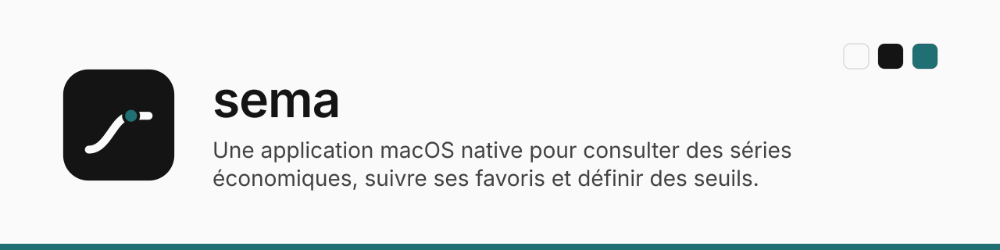

<!-- carte:en-tete:debut — fabriqué depuis projet.yml par sophos/outils/carte.mjs ; ne pas modifier à la main -->
# sema

<picture>
  <source media="(prefers-color-scheme: dark)" srcset=".github/carte/banniere-sombre.svg">
  
</picture>

**Raison d'être** Que chacun garde à portée de main les repères économiques publics qui comptent pour lui, avec leur source, leur unité et leur date.

**État** actif · **Sorte** application macOS · **Adresse** [getsema.app](https://getsema.app)
<!-- carte:en-tete:fin -->

## Ce que c'est

sema est une application macOS native pour consulter des séries économiques publiques (taux, inflation, devises), retrouver ses favoris et suivre des seuils. Chaque série garde sa source, son unité et ses dates. Le détail est dans [docs/fondation.md](docs/fondation.md).

## Démarrer

Pour installer l'app : télécharger le DMG sur [getsema.app](https://getsema.app/download/), ou lancer `brew install --cask antoineberjoan/sema/sema-app`. La version alpha porte une signature ad hoc et n'est pas notarisée par Apple : macOS peut bloquer la première ouverture (voir [la distribution](docs/DISTRIBUTION.md)).

Pour développer (macOS 14 ou plus, Swift 6, Xcode complet) :

```sh
./scripts/setup.sh
./controler.sh
./scripts/check.sh
./scripts/build-app.sh
open build/Sema.app
```

Quand l'app s'ouvre, une icône apparaît dans la barre de menus. Les préférences et caches restent sur le Mac, dans `~/Library/Application Support/Sema/`.

## Organisation du dépôt

- `Sources/MarketCore/` : le cœur. Séries, alertes, préférences, connecteurs aux sources de données.
- `Sources/SemaDesign/` : les jetons de design, fabriqués depuis `Resources/Brand/tokens.json`.
- `Sources/SemaMac/` : l'app macOS. Écrans, état, adaptation au système.
- `Tests/MarketCoreTests/`, `Tests/SemaDesignTests/`, `Tests/SemaMacTests/` : les preuves du cœur, des jetons et de l'app.
- `Resources/` : métadonnées du bundle et marque.
- `scripts/` : construction, contrôles, distribution.
- `site/` : le site statique.
- `distribution/` : le manifeste de release et le cask public.
- `docs/` : fondation, produit, décisions, lexique, sources de données, catalogues publics, personnalisation, distribution, mentions légales ([LEGAL.md](docs/LEGAL.md)), retours ([FEEDBACK.md](docs/FEEDBACK.md)).

## Liens avec les autres projets

<!-- carte:liens:debut — fabriqué depuis projet.yml par sophos/outils/carte.mjs ; ne pas modifier à la main -->
Aucun lien avec un autre dépôt.
<!-- carte:liens:fin -->

## Règles et décisions

- Ce qu'est le projet : [docs/fondation.md](docs/fondation.md).
- Les règles pour les agents de code : [AGENTS.md](AGENTS.md).
- Les décisions, une par fichier daté : `docs/decisions/`.
- Le produit et ses données : [docs/PRODUCT.md](docs/PRODUCT.md), [sources de données](docs/DATA-SOURCES.md), [catalogues publics](docs/PUBLIC-CATALOGUES.md), [personnalisation](docs/PERSONALIZATION.md).
- Pour contribuer : [CONTRIBUTING.md](CONTRIBUTING.md). Pour signaler une faille : [SECURITY.md](SECURITY.md).

## Licence

[MIT](LICENSE), pour le code et la documentation. Elle ne remplace pas les conditions de réutilisation des données des fournisseurs ([sources de données](docs/DATA-SOURCES.md)).
