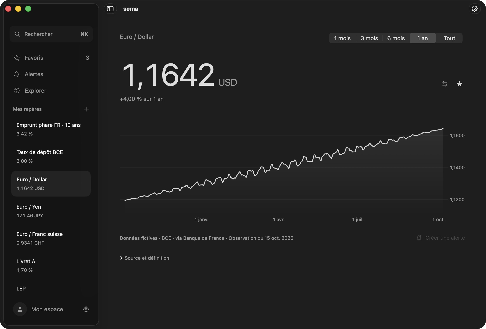

# sema

**Vos repères, à portée de main.** Une application macOS native pour consulter des séries économiques, retrouver ses favoris et suivre des seuils sur les taux, l’inflation et les devises.

[Installer sema](https://getsema.app/download/) · [Signaler un bug](https://github.com/antoineberjoan/sema/issues/new?template=bug.yml) · [Contribuer](CONTRIBUTING.md) · [Licence MIT](LICENSE)



*Aperçu de l’interface conservé sur le site, avec données fictives datées du 15 octobre 2026. Les détails peuvent différer de la version actuelle.*

## Installer

La version distribuée demande **macOS 14 ou plus récent et un Mac avec puce Apple**. Télécharger le DMG sur [getsema.app](https://getsema.app/download/), puis glisser sema dans Applications, ou utiliser Homebrew :

```sh
brew install --cask antoineberjoan/sema/sema-app
```

Pour une installation Homebrew existante :

```sh
brew update
brew upgrade --cask antoineberjoan/sema/sema-app
```

La version alpha porte une signature ad hoc et **n’est pas notarisée par Apple**. macOS peut bloquer sa première ouverture. Après avoir vérifié la provenance du téléchargement, suivre la [procédure Apple](https://support.apple.com/fr-fr/102445). Homebrew ne supprime pas cette étape. Voir les [vérifications et limites de la distribution](docs/validation/distribution-0.7.0.json).

## Ce que fait sema

- Explorer les catalogues économiques de Webstat, de la BCE, de l’Insee et d’autres producteurs publics, puis choisir ses séries.
- Lire un repère et son historique dans Focus ; consulter ses favoris dans un bandeau accessible depuis la barre de menus.
- Garder les observations en cache pour les relire hors connexion.
- Définir des seuils et recevoir une notification lorsque les nouvelles observations franchissent ces seuils.
- Personnaliser le bandeau, les raccourcis et l’apparence.

Les dates, unités et sources accompagnent les séries. Les [catalogues pris en charge et leurs limites](docs/PUBLIC-CATALOGUES.md) précisent la couverture réelle.

## Sources et données personnelles

Webstat demande une clé personnelle gratuite, à créer dans son [espace utilisateur](https://webstat.banque-france.fr/login/) puis à saisir dans **Réglages → Sources**. Elle est validée avant stockage dans le Trousseau macOS. Les catalogues publics accessibles sans clé restent disponibles indépendamment de Webstat.

Les préférences et caches restent sur le Mac, dans `~/Library/Application Support/Sema/`. Les clés ne sont pas enregistrées dans ces fichiers. Les requêtes de données vont aux fournisseurs concernés ; leurs conditions de réutilisation s’appliquent. Voir [les sources de données](docs/DATA-SOURCES.md).

## Limites actuelles

- Les données suivent la fréquence de leurs producteurs ; ce ne sont pas des cotations garanties en temps réel.
- L’app vérifie les séries suivies au lancement, au réveil et à échéance lorsque leur dernière synchronisation remonte à au moins 24 heures. L’actualisation manuelle reste disponible. Les alertes sont évaluées sur les nouvelles observations ; aucune surveillance ne tourne lorsque sema est quittée. Voir [l’actualisation quotidienne](docs/plans/automatic-refresh.md).
- La version binaire distribuée cible Apple Silicon ; aucune version Intel n’est proposée.
- L’installation et la mise à jour Homebrew sont vérifiées. Le parcours complet de première ouverture sur un autre Mac reste à valider.

## Développer et contribuer

Le projet utilise SwiftUI, AppKit et les frameworks Apple, sans dépendance externe pour l’app. Prévoir Swift 6, macOS 14+ et Xcode complet pour la suite Swift Testing.

```sh
git clone https://github.com/antoineberjoan/sema.git
cd sema
./scripts/setup.sh
./scripts/check.sh
./scripts/build-app.sh
open build/Sema.app
```

[CONTRIBUTING.md](CONTRIBUTING.md) explique comment proposer un changement. [AGENTS.md](AGENTS.md) est l’unique entrée des règles pour les assistants ; les instructions liées ne sont pas dupliquées ici.

Pour comprendre le code : [produit](docs/PRODUCT.md), [architecture](docs/ARCHITECTURE.md), [structure des dossiers](.agents/structure.json) et [plans techniques](docs/PLAN.md). Le site statique est dans [site/](site/README.md) ; le cask et les binaires sont publiés dans [homebrew-sema](https://github.com/antoineberjoan/homebrew-sema).

## Retours et sécurité

Une question, un bug reproductible ou une idée : [ouvrir une issue](https://github.com/antoineberjoan/sema/issues/new/choose). Une vulnérabilité doit suivre [SECURITY.md](SECURITY.md).

## Licence

Code et documentation sous [licence MIT](LICENSE). Cette licence ne remplace pas les conditions d’accès et de réutilisation des données des fournisseurs.
