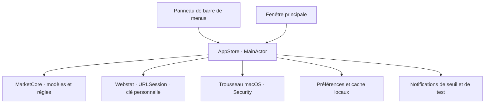

# Architecture

## Organisation actuelle

Un seul package Swift, deux cibles de production et une cible de tests. Aucun service distant propre à Sema.

### MarketCore

- `MarketSeries` : série typée, origine, source et observations triées et dédupliquées.
- `AlertRule` / `AlertEvaluator` : seuil absolu et direction sur une série macro précise, évaluation pure de chaque paire d’observations et checkpoint persistant. Une ancienne règle sans condition conserve son sens de variation relative sur fonds.
- `ECBExchangeRateClient` : téléchargement des 90 derniers jours, validation HTTP et lecture XML sans entités externes.
- `WebstatClient` : export JSON groupé des 13 séries explicites sur six ans pour couvrir une fenêtre complète de cinq ans malgré le décalage des publications mensuelles ; clé dans le header `Authorization`, validation HTTP, valeurs manquantes et dates d’observation. Un export incomplet n’est pas appliqué.
- `PreferencesStore` : document JSON versionné, lecture explicite des erreurs et écriture atomique.
- `DemoCatalog` : fixtures fixes et identifiées comme telles, sans dépendance au réseau.

### SemaMac

- `AppStore` est l’état partagé et le point de coordination. Il ne dessine pas l’interface.
- `Features` présente les données et émet les actions utilisateur.
- `DesignSystem` contient les couleurs adaptées à l’apparence système, les composants partagés et les graphiques.
- `Infrastructure` contient les effets dépendants de macOS : chemins de stockage et notifications système.
- `WebstatKeychain` utilise Security dans un acteur séparé du MainActor. La clé n’est jamais incluse dans les fichiers de préférences, dans le cache, dans une URL ou dans le binaire. Aucun service serveur ni bibliothèque externe n’est ajouté.

Les états de sélection sont partagés volontairement entre panneau et fenêtre. Une action sur un favori doit être visible immédiatement dans les deux.

## Persistance

Les préférences et les règles restent un petit document local. Le cache des devises est séparé, car il peut être régénéré. Les préférences illisibles ne sont jamais remplacées automatiquement.

Les historiques restent immuables. Une connexion Webstat réussie remplace les séries macro reçues. L’interface n’expose plus les fonds de démonstration ; leurs préférences historiques sont conservées. Le cache `webstat-cache.json` est écrit atomiquement ; l’ancien cache BCE peut encore être lu si aucun cache Webstat n’existe. Aucun appel BCE direct n’est exposé dans l’interface actuelle.

La connexion valide les données avant d’enregistrer la clé. Une erreur HTTP, un quota atteint ou une erreur de décodage conserve le cache et les données affichées ; aucun nouvel essai automatique ne tourne. Le bouton d’actualisation utilise ensuite la clé du Trousseau. Retirer la clé conserve volontairement les données publiques déjà téléchargées. Le cache est relu au lancement, l’actualisation reste manuelle.

Les observations Webstat conservent la fin de période, le statut et la date de mise à jour source. Une période mensuelle peut se terminer dans le futur si le taux est déjà applicable dans le mois courant. Les fenêtres des séries mensuelles et les fenêtres annuelles utilisent le calendrier civil. Le sélecteur propose 1 mois, 3 mois, 1 an, 3 ans et 5 ans uniquement si la série couvre la période. Les caches antérieurs, sans ces métadonnées optionnelles, restent lisibles.

## Alertes

Le moteur est testable et indépendant du transport de notification. Il vérifie les nouvelles observations réelles lors de chaque actualisation Webstat réussie. Aucun minuteur, service en arrière-plan ou serveur ne tourne. Une simulation explicite reste disponible et ne modifie pas le checkpoint réel.

Une surveillance future s’ajoutera à l’orchestration. Si elle doit continuer indépendamment du Mac, elle exigera un service côté serveur. Une notification APNs n’assure pas une réception instantanée sur un appareil éteint ou hors ligne.

## Évolutions conditionnelles

- Introduire un fournisseur supplémentaire uniquement lorsque son contrat de données et ses droits sont validés.
- Ajouter une interface commune aux fournisseurs si plusieurs implémentations doivent réellement être substituées ; ne pas construire ce cadre à l’avance.
- Passer à SwiftData si le volume ou les requêtes locales le justifient ; une migration devra préserver les préférences existantes.
- Ajouter un projet Xcode d’app si les besoins de distribution, d’assets ou d’entitlements le rendent utile. Le package Swift et le script de bundle sont la source actuelle de compilation.

### Contrat des alertes de seuil

- Règles sur la valeur absolue dans l’unité du repère : par exemple 3,5 % pour un taux, pas une hausse relative de 3,5 %. Zéro et les seuils négatifs sont admis.
- Franchissement strict : de ≤ seuil vers > seuil, ou de ≥ seuil vers < seuil. Rester au-delà ne redéclenche pas.
- Une nouvelle règle prend la dernière observation réelle comme point de départ. Une première connexion après création en démonstration établit ce point sans émettre de signal historique. La réactivation reprend à la dernière observation disponible.
- Chaque paire nouvelle depuis `lastEvaluatedAt` est évaluée, y compris les franchissements intermédiaires si plusieurs publications arrivent entre deux actualisations. Les révisions d’une date déjà traitée ne renvoient pas de notification.
- Les checkpoints sont enregistrés atomiquement avant l’envoi système ; si la sauvegarde échoue, aucun envoi n’est effectué. Il n’y a pas de nouvelle tentative automatique après un échec de livraison. Les derniers signaux restent visibles pendant la session, les checkpoints persistent après relancement.
- Les thèmes sont identifiés par une chaîne optionnelle dans les préférences de version 1. Un ancien document sans thème utilise Sarcelle ; aucune migration destructive n’est nécessaire.
