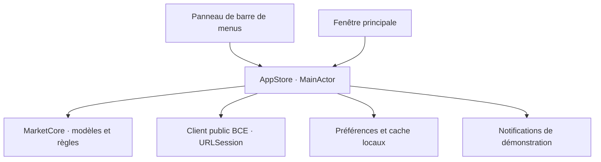

# Architecture

## Organisation actuelle

Un seul package Swift, deux cibles de production et une cible de tests. Aucun service distant propre à Sema.

### MarketCore

- `MarketSeries` : série typée, origine, source et observations triées et dédupliquées.
- `AlertRule` / `AlertEvaluator` : seuil, direction, part exacte, évaluation pure et déduplication par date d’observation.
- `ECBExchangeRateClient` : téléchargement des 90 derniers jours, validation HTTP et lecture XML sans entités externes.
- `PreferencesStore` : document JSON versionné, lecture explicite des erreurs et écriture atomique.
- `DemoCatalog` : fixtures fixes et identifiées comme telles, sans dépendance au réseau.

### SemaMac

- `AppStore` est l’état partagé et le point de coordination. Il ne dessine pas l’interface.
- `Features` présente les données et émet les actions utilisateur.
- `DesignSystem` contient les couleurs adaptées à l’apparence système, les composants partagés et les graphiques.
- `Infrastructure` contient les effets dépendants de macOS : chemins de stockage et notifications système.

Les états de sélection sont partagés volontairement entre panneau et fenêtre. Une action sur un favori doit être visible immédiatement dans les deux.

## Persistance

Les préférences et les règles restent un petit document local. Le cache des devises est séparé, car il peut être régénéré. Les préférences illisibles ne sont jamais remplacées automatiquement.

Les historiques restent immuables. Une actualisation BCE remplace seulement les séries de devises reçues. Les autres données de démonstration gardent leur origine propre.

## Alertes

Le moteur est testable et indépendant du transport de notification. La version 0.1 n’exécute ce moteur que lors d’une simulation explicite ; aucun minuteur ou service ne surveille les fonds.

Une surveillance future s’ajoutera à l’orchestration. Si elle doit continuer indépendamment du Mac, elle exigera un service côté serveur. Une notification APNs n’assure pas une réception instantanée sur un appareil éteint ou hors ligne.

## Évolutions conditionnelles

- Introduire un fournisseur supplémentaire uniquement lorsque son contrat de données et ses droits sont validés.
- Ajouter une interface commune aux fournisseurs si plusieurs implémentations doivent réellement être substituées ; ne pas construire ce cadre à l’avance.
- Passer à SwiftData si le volume ou les requêtes locales le justifient ; une migration devra préserver les préférences existantes.
- Ajouter un projet Xcode d’app si les besoins de distribution, d’assets ou d’entitlements le rendent utile. Le package Swift et le script de bundle sont la source actuelle de compilation.
