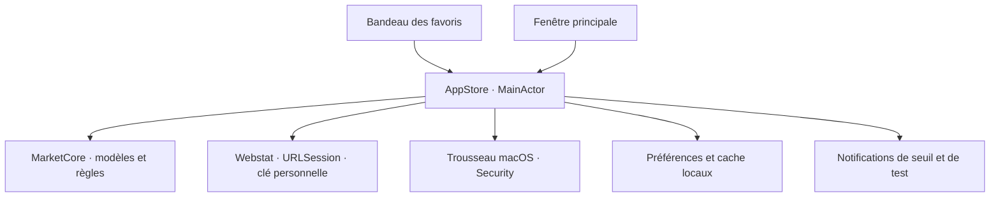

# Architecture

## Organisation actuelle

Un seul package Swift, deux cibles de production et une cible de tests. Aucun service distant propre à sema.

### MarketCore

- `MarketSeries` : série typée, origine, source et observations triées et dédupliquées.
- `StatisticalClient` / `SDMXParser` : découverte des catalogues publics Insee, BCE, Eurostat, BRI et OCDE, puis structure et combinaison choisie par l’utilisateur. Les listes de codes externes référencées sont téléchargées si nécessaire. Les API JSON de taux de référence New York et d’indicateurs Banque mondiale partagent ce contrat de découverte, avec un décodage adapté. Aucun secret Webstat ne leur est transmis.
- `StatisticalSeriesDescriptor` : source, agence, jeu, version, clé, dimensions, attributs et libellés officiels. Propriété optionnelle de `MarketSeries`, compatible avec les caches précédents. L’interface n’a pas de liste autorisée de séries : elle lit les catalogues, puis charge un repère unique. Contrats détaillés dans [PUBLIC-CATALOGUES.md](PUBLIC-CATALOGUES.md).
- `AlertRule` / `AlertEvaluator` : seuil absolu et direction sur une série macro précise, évaluation pure de chaque paire d’observations et checkpoint persistant. Une ancienne règle sans condition conserve son sens de variation relative sur fonds.
- `ECBExchangeRateClient` : téléchargement des 90 derniers jours, validation HTTP et lecture XML sans entités externes.
- `WebstatClient` : découverte des jeux `webstat-datasets`, recherche paginée `series` (50 résultats par offset, tri sur la clé unique). Au-delà de 9 950 résultats parcourus, un export limité aux sept champs utiles aux résultats est chargé à la demande, réutilisé pour la même recherche et paginé localement. La fiche recharge toujours le descripteur officiel complet avant ses observations, libellés `codelists`, exports `observations` bornés par dates. La clé reste dans le header `Authorization` d’un hôte fixe. Échappement ODSQL, code exact et filtres validés. L’ancien export groupé reste disponible pour compatibilité ; le catalogue et les actualisations utilisent des séries dynamiques.
- `WebstatSeriesDescriptor` : description indépendante des observations, métadonnées brutes `WebstatValue`, dimensions et attributs officiels, unité/multiplicateur/décimales séparés, fréquence étendue et bornes publiées. Les listes de codes du jeu traduisent les valeurs sans effacer les codes. Les unités inconnues restent consultables ; un seuil exige une unité explicitement traduite et son échelle.
- `MarketSeries.descriptor` : optionnel pour relire les caches historiques. Les observations gardent `Decimal` et leur échelle source. `HistoryPeriod.all` expose la couverture reçue ; les bornes fin-de-période du catalogue sont normalisées au début de période pour inclure la première observation.
- `ExchangeRatePair` reconnaît uniquement les cotations au comptant contre euro déjà vérifiées par `SeriesEquivalence`, ainsi que les fixtures identifiées. `invertedExchangeRateForDisplay()` calcule `1 / valeur` en `Decimal` sur toutes les observations et conserve leurs dates, périodes, statuts et mises à jour. Sa projection sans descripteur sert seulement à l’affichage ; cache, chargements et alertes utilisent toujours la série publiée. Les variations sont recalculées à partir des réciproques, jamais obtenues en changeant simplement le signe.
- `PreferencesStore` : document JSON versionné, lecture explicite des erreurs et écriture atomique.
- `SeriesSearch` : recherche locale pure, normalisation des accents/casse et alias. `AppStore` orchestre séparément le catalogue distant, avec tâches annulables et jeton de génération empêchant une ancienne réponse de remplacer la requête courante. Explorer et ⌘K partagent le navigateur et l’aperçu.
- `DemoCatalog` : fixtures fixes et identifiées comme telles, sans dépendance au réseau.

### SemaMac

Le bundle déclare `LSUIElement = true` : sema est une app accessoire macOS, absente du Dock, qui conserve ses fenêtres SwiftUI. Le clic droit sur le `NSStatusItem` affiche trois actions dans un `NSMenu` AppKit avec SF Symbols et séparateurs : Réglages…, Rechercher des mises à jour… et Quitter sema. L’action de mise à jour ouvre uniquement `https://github.com/antoineberjoan/homebrew-sema/releases` avec `NSWorkspace.open` ; aucun jeton, vérificateur périodique, téléchargement ou installateur n’est ajouté. Aucun changement dynamique de politique d’activation n’est nécessaire.

- `AppStore` est l’état partagé et le point de coordination. Il ne dessine pas l’interface.
- `SemaCommands` expose les actions de navigation et de recherche dans les menus natifs et ouvre la fenêtre si nécessaire. Les feuilles de recherche et d’alerte partagent l’état local, avec exclusion des commandes de navigation pendant une feuille.
- `Features` présente les données et émet les actions utilisateur.
- `WorkspaceView` pilote trois présentations locales de sidebar : ouverte à demeure, fermée et aperçu au survol. Les deux premières commandent le `NavigationSplitView` ; la troisième réemploie le même contenu dans une superposition en matière native, sans redimensionner le graphique. Une tâche annulable de 220 ms couvre le passage entre le bouton et le panneau ; l’entrée dans une zone annule toute fermeture. La désactivation de la scène et les feuilles ferment l’aperçu. La liste des repères a rejoint sa sidebar ; le profil « Mon espace » reste hors de sa zone défilante. `OverviewView` présente le détail Focus sans `Surface` imbriquée, puis les accès rapides uniquement en mode détail seul. `SeriesDetailView` partage toujours les règles d’historique, les sources, l’inversion et les alertes avec les aperçus du catalogue. Le bandeau et `AppStore` restent inchangés. Aucun nouveau champ de préférences ni migration.
- `MenuRibbonView` affiche les favoris partagés, sans deuxième sélection ni requête automatique. `MenuRibbonController` utilise un `NSStatusItem` et un `NSPanel` non activant pour se placer en haut, en bas, à gauche ou à droite dans la zone visible de l’écran. Le champ optionnel `ribbonPositionID` conserve ce choix en v2 ; un identifiant absent ou inconnu se replie sur le haut sans effacer les préférences. Le panneau est transparent et sans ombre commune. En haut et en bas, une colonne SwiftUI de 76 pt partage la hauteur de 184 pt des cartes et regroupe les sept périodes, leur état de sélection accessible et les réglages. Le panneau horizontal ne réserve plus de rangée sous les cartes ; les positions latérales gardent leur sélecteur compact. Chaque carte utilise son propre `NSVisualEffectView` en mode `behindWindow`, matière `underWindowBackground`, derrière les textes SwiftUI pour préserver leurs couleurs sémantiques. Une surface opaque remplace le verre de chaque carte avec Réduire la transparence ou Augmenter le contraste. Le délégué de l’app le conserve quand le hub est fermé. Le contenu reste en SwiftUI, les mini-courbes en Swift Charts. Les écouteurs de souris et de clavier local sont installés uniquement pendant la présentation, puis retirés à la fermeture ; aucun raccourci global ni permission d’accessibilité supplémentaire n’est demandé. Les transitions interrompues vérifient leur génération avant de masquer le panneau. Les actions vers le hub et les réglages utilisent les actions SwiftUI de scène.
- `RibbonSignatureView` réutilise `SemaSignalPath` avec `trim` : une seule tâche annulable pilote trois étapes nommées, déclenchées uniquement par la présentation, sans bouton Rejouer. Aucun minuteur permanent ; Réduire les animations présente immédiatement le résultat. La fermeture termine la présentation et annule la séquence.
- `DesignSystem` contient les couleurs adaptées à l’apparence système, les composants partagés et les graphiques.
- `Infrastructure` contient les effets dépendants de macOS : chemins de stockage et notifications système. `SemaFeedback` lit l’URL HTTPS du formulaire dans `SemaFeedbackFormURL` du bundle. Le bouton utilise `NSWorkspace.open` sur le MainActor ; son échec propose de copier le lien. Aucun jeton Notion ni service serveur n’est embarqué.
- `WebstatKeychain` utilise Security dans un acteur séparé du MainActor. La clé n’est jamais incluse dans les fichiers de préférences, dans le cache, dans une URL ou dans le binaire. Aucun service serveur ni bibliothèque externe n’est ajouté.

Le champ optionnel `appearanceID` en v2 conserve le mode Système / Clair / Sombre ; absent ou inconnu, il suit macOS. `SemaAppearance` résout ce choix pour SwiftUI et AppKit : `preferredColorScheme` sur les scènes et le bandeau, `NSApplication.appearance` pour les fenêtres et matières natives. `SemaPalette.glassTint` applique une teinte légère aux cartes, transparente en Graphite, sans modifier les chiffres ni la couleur du signe de la barre de menus. Le champ optionnel `ribbonGlass` en v2 conserve trois valeurs de 0 à 1 dans `RibbonGlassPreferences` : transparence (0,75 par défaut), teinte (0,5) et grain (0). Son absence préserve le rendu précédent sans réécriture du fichier. Les valeurs sont normalisées au décodage ; palette, mode et position restent indépendants. L’environnement SwiftUI transmet ces réglages à chaque `RibbonSurface`. La transparence module uniquement le voile de contraste ; aucun rayon de flou privé ni capture du bureau. Le grain utilise une tuile déterministe en mémoire, sans animation ni boucle de rendu. La surface opaque d’accessibilité ignore ces réglages. Apparence réemploie la première `RibbonCard` favorite comme aperçu non interactif et permet de réinitialiser uniquement le verre.

Les états de sélection sont partagés volontairement entre panneau et fenêtre. Une action sur un favori doit être visible immédiatement dans les deux.

### Navigation clavier

`GlobalShortcuts` réserve les deux combinaisons via `RegisterEventHotKey` et un gestionnaire Carbon natif. Aucun observateur global de frappe ni permission d’accessibilité n’est ajouté. Les remplacements sont réservés avant de libérer les anciens ; une erreur de réservation ou de sauvegarde conserve le réglage précédent. L’enregistrement suspend les réservations de sema, capture les touches dans son seul champ puis les rétablit à la sortie, y compris à la fermeture de la fenêtre.

`FocusKeyboard` observe uniquement les événements locaux de la fenêtre principale, hors saisie, contrôle de valeur et feuille. `WorkspaceView` possède le choix provisoire du sélecteur ; `AppStore.show` n’est appelé qu’à la validation. Un changement de fenêtre, une feuille ou Échap annule ce choix. Les calculs et données ne sont pas dupliqués. `HistoryPeriods` partage les cinq horizons visibles entre les deux surfaces ; les autres cas du modèle historique restent disponibles aux calculs existants.

## Persistance

Le champ optionnel v2 `shortcuts` conserve les deux combinaisons ; son absence utilise les valeurs initiales, tandis qu’une action explicitement nulle reste désactivée. Les préférences existantes gardent leur sélection et leurs favoris. Les quatre favoris initiaux concernent uniquement un document de préférences absent.

Le champ optionnel v2 `invertedCurrencyPairs` conserve les paires lues à l’inverse (par exemple `EUR/USD`), indépendamment du point d’accès Webstat/BCE et de la fréquence. Absent, il conserve le sens publié. `AppStore.displayedSeries` applique cette préférence aux seules vues ; le changement est sauvegardé atomiquement avant application. Un cache en mémoire conserve la projection par identifiant avec sa série source : tant que celle-ci est égale, le bouton réutilise les points inversés. Une modification de valeur, date ou métadonnée force le recalcul, sans second appel API ni deuxième cache sur disque. Le survol du graphique est réinitialisé lorsque l’unité change.

Les préférences et les règles restent un petit document local. Le cache des devises est séparé, car il peut être régénéré. Les préférences illisibles ne sont jamais remplacées automatiquement.

Les champs optionnels v2 `profile`, `disabledSourceIDs` et `alertBaselineIDs` portent le profil local (dont le petit JPEG), les sources suspendues et les règles à réinitialiser après reprise. `AppStore` garde les générations des requêtes pour ignorer les réponses dépassées. `SeriesEquivalence` regroupe uniquement les correspondances de taux de change BCE/Webstat vérifiées ; les identifiants et caches d’origine restent distincts. Le contrat et la validation sont détaillés dans [PERSONALIZATION.md](PERSONALIZATION.md).

Les historiques restent immuables. Une actualisation réussie fusionne les observations reçues pour chaque série ; l’échec d’une série conserve son historique et n’efface pas les autres. L’interface n’expose plus les fonds de démonstration ; leurs préférences historiques sont conservées. Le cache `webstat-cache.json` est écrit atomiquement et conserve son nom pour compatibilité ; il contient aussi les observations publiques et leur descripteur optionnel. Les catalogues publics sont écrits séparément dans `statistical-catalogues.json`. L’ancien cache BCE peut encore être lu si aucun cache Webstat n’existe. L’accès direct BCE SDMX passe désormais par Explorer.

La connexion valide les données avant d’enregistrer la clé. Une erreur HTTP, un quota atteint ou une erreur de décodage conserve le cache et les données affichées ; le prochain contrôle automatique conserve ces erreurs tant que les séries concernées ne sont pas actualisées avec succès. Le bouton d’actualisation utilise ensuite la clé du Trousseau. Retirer la clé conserve volontairement les données publiques déjà téléchargées. Le cache est relu au lancement. `RefreshPolicy` fixe une fraîcheur de 24 h sur `syncedAt`, distincte de la date de publication. Le contrôleur natif conservé par le délégué d’app vérifie au lancement et au réveil, puis programme la plus ancienne échéance avec un minuteur commun, même sans fenêtre. Il ne récupère que les séries suivies, activées et connectées devenues anciennes. Une actualisation déjà en cours est laissée terminer ; le contrôle reprend après un court délai. Un échec conserve le cache et reporte son prochain essai automatique au lendemain, sans bloquer les échéances des autres séries. ⌘R force toujours une mise à jour.

Les observations Webstat conservent la fin de période, le statut et la date de mise à jour source. Une période mensuelle peut se terminer dans le futur si le taux est déjà applicable dans le mois courant. Les fenêtres des séries mensuelles et les fenêtres annuelles utilisent le calendrier civil. Le sélecteur propose 1 mois, 3 mois, 6 mois, 1 an, 3 ans et 5 ans uniquement si la série couvre la période et contient plusieurs points, ainsi que Tout. Les périodes anciennes se chargent en tranches de six années, avec progression et annulation. Une réduction min/max borne les points dessinés pour les longues courbes ; le survol consulte les observations originales. Les caches antérieurs, sans ces métadonnées optionnelles, restent lisibles.

## Alertes

Le moteur est testable et indépendant du transport de notification. Il vérifie les nouvelles observations réelles lors de chaque actualisation réussie d’un repère suivi, quelle que soit sa source. Le minuteur quotidien tourne avec l’app, y compris hub fermé ; il est suspendu en veille et arrêté à la sortie. Aucun serveur ni réveil forcé du Mac. Une simulation explicite reste disponible et ne modifie pas le checkpoint réel.

Une surveillance indépendante du Mac exigerait un service côté serveur. Une notification APNs n’assure pas une réception instantanée sur un appareil éteint ou hors ligne.

## Évolutions conditionnelles

- Introduire un fournisseur supplémentaire uniquement lorsque son contrat de données et ses droits sont validés.
- Ajouter une interface commune aux fournisseurs si plusieurs implémentations doivent réellement être substituées ; ne pas construire ce cadre à l’avance.
- Passer à SwiftData si le volume ou les requêtes locales le justifient ; une migration devra préserver les préférences existantes.
- Ajouter un projet Xcode d’app si les besoins de distribution, d’assets ou d’entitlements le rendent utile. Le package Swift et le script de bundle sont la source actuelle de compilation.

### Contrat des alertes de seuil

- Règles sur la valeur absolue dans l’unité du repère : par exemple 3,5 % pour un taux, pas une hausse relative de 3,5 %. Zéro et les seuils négatifs sont admis.
- Franchissement strict : de ≤ seuil vers > seuil, ou de ≥ seuil vers < seuil. Rester au-delà ne redéclenche pas.
- Une nouvelle règle prend la dernière observation réelle comme point de départ. Une première connexion après création en démonstration établit ce point sans émettre de signal historique. La réactivation reprend à la dernière observation disponible.
- Chaque paire nouvelle depuis `lastEvaluatedAt` est évaluée, y compris les franchissements intermédiaires si plusieurs publications arrivent entre deux actualisations. Les révisions d’une date déjà traitée ne renvoient pas de notification.
- Les checkpoints sont enregistrés atomiquement avant l’envoi système ; si la sauvegarde échoue, aucun envoi n’est effectué. Il n’y a pas de nouvelle tentative automatique après un échec de livraison. Les derniers signaux restent visibles pendant la session, les checkpoints persistent après relancement.
- Les thèmes sont identifiés par une chaîne optionnelle dans les préférences de version 1. Graphite est le thème initial et le repli d’un document sans thème ou avec un identifiant inconnu. Les choix déjà enregistrés restent conservés ; aucune migration destructive n’est nécessaire.

### Sélection et migration v2

`followedSeriesIDs` porte l’ordre des clés Webstat. `favoriteIDs` en épingle un sous-ensemble. Les séries en cache ne sont pas toutes suivies : retirer une série conserve ses données et met ses règles en pause. Toute mutation de préférences est écrite avant d’être appliquée à l’état visible. `selectedSeries` est optionnel, ce qui permet un panorama vide sans accès à `series[0]`.

`PreferencesStore.load` et `LocalStorage.cachedWebstat` lisent v1 et v2, créent une copie du document v1 puis écrivent la migration atomiquement. Favoris, règles, UUID et checkpoints conservent leur sens. La clé du Trousseau n’est jamais copiée dans cette migration. `webstat-catalogue.json` conserve les jeux et libellés publics ; les observations et leurs descripteurs restent dans `webstat-cache.json` v2.

Contrat d’accueil : `WebstatClient.starterSeries`, `AppStore.followStarterSeries(ids:) -> Bool`, `AppStore.follow(_:) async -> Bool` et `AppStore.commit(_:) -> Bool`. Rejouer la sélection de départ conserve les séries personnelles hors sélection initiale et met en pause les alertes des repères de départ retirés. Le champ optionnel `onboardingCompleted` est mis à `true` lors de la migration v1 ; sa présentation est orchestrée par l’app.

Un changement d’unité, de multiplicateur ou de base d’indice empêche de fusionner l’ancien et le nouvel historique. Les périodes récentes reçues remplacent la courbe, l’interface explique la vérification nécessaire et les alertes concernées sont mises en pause avant toute évaluation. Le chargement de « Tout » vérifie d’abord que les métadonnées courantes correspondent à celles de la fiche ; sinon il demande une actualisation.
