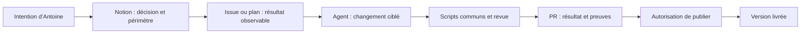

# Fonctionnement du socle agentique

Le système rend le travail reproductible et vérifiable. Il ne rend pas un modèle déterministe et ne garantit pas l’absence de défaut. L’intention reste humaine ; les agents réalisent, les outils vérifient et les preuves restent consultables.

## Chaîne de travail

Une correction technique à périmètre inchangé n’exige pas de créer une page Notion ou un plan. Une demande claire autorise sa réalisation locale ; seuls les arbitrages réels et les actions externes non couvertes interrompent le travail.

## Couches et coût de contexte

| Élément | Usage | Chargement |
| --- | --- | --- |
| [AGENTS.md](../../AGENTS.md) | Autorité, règles communes, orientation | Toujours |
| Instructions de zone | Invariants du cœur, de l’app ou du site | Zone touchée uniquement |
| [Conventions](CONVENTIONS.md), [glossaire](GLOSSARY.md) | Responsabilités, constantes et vocabulaire | Lors d’un ajout ou d’un doute |
| [sema-change](../../.agents/skills/sema-change/SKILL.md) | Exécuter un changement vérifiable | Fonctionnalité ou chantier complexe |
| [sema-design](../../.agents/skills/sema-design/SKILL.md) | Interface Craft appliqué aux supports de sema | Design, copy ou mouvement |
| [sema-handoff](../../.agents/skills/sema-handoff/SKILL.md) | Préserver le contexte utile | Relais ou fin de chantier |
| [guardrails.py](../../scripts/guardrails.py) | Contrats mécaniques | Local, pre-commit et CI |

Pas de copie des règles dans quatre configurations, pas de rôles permanents ni de flotte d’agents sans besoin. Une « compétence » répétable est une skill ; une contrainte brève est une règle ; un fait vérifiable est un contrôle ; une décision durable est une note de décision. Ne pas ajouter un de ces objets pour une préférence ponctuelle.

## Utiliser un autre agent

Les documentations officielles ont été consultées le 17 octobre 2026 ; la prise en charge dépend de la version et des réglages de chaque outil.

| Agent | Entrée | Procédures |
| --- | --- | --- |
| Codex | `AGENTS.md` | `.agents/skills` découvert par le client |
| Claude Code | `CLAUDE.md` importe `AGENTS.md` | `.claude/skills` expose les skills communes par liens symboliques, sans copie |
| Cursor | `AGENTS.md` | `.agents/skills` découvert par le client |
| Antigravity | `AGENTS.md` | `.agents/skills` découvert par le client |
| Autre agent | Lui demander de lire `AGENTS.md` | Même lecture ciblée et mêmes scripts |

Une skill peut être demandée explicitement : « Applique sema-design à ce changement ». Cursor et Claude proposent aussi `/sema-design` dans leur catalogue natif ; l’invocation explicite dépend du client. Les trois liens de `.claude/skills` conservent les mêmes noms et pointent vers `.agents/skills`, seule source à éditer. Le contrôle refuse un lien absent, détourné, remplacé par une copie ou un simple fichier texte. Le clone Git doit conserver les liens symboliques ; aucune copie de secours n’est maintenue. La table de routage reste utilisable par les autres agents.

Sur un nouvel outil, demander d’identifier les sources d’instructions chargées et la commande de validation, puis faire une petite tâche réversible. La découverte automatique et l’obéissance effective ne sont pas validées par la simple présence des fichiers. Le [test des clients](../validation/agent-clients.md) distingue catalogue, lecture et exécution : Cursor et Claude chargent les trois skills et les instructions Mac. Claude a aussi lu Notion et GitHub puis corrigé un garde-fou avec test avant/après. Cursor lit GitHub ; sa connexion Notion attend une autorisation et son changement réel est arrêté par le quota Agent. Antigravity reste non testé.

Les connexions et permissions restent propres à chaque client. Avant un chantier qui dépend de Notion, lire réellement la page source avec son connecteur ; un catalogue ou l’état « connecté » ne suffisent pas. Pour GitHub, le terminal `gh` authentifié peut lire la PR privée et effectuer les opérations autorisées sans ajouter un second connecteur. Ne pas copier de jeton dans Git ou entre clients. Une connexion sans accès à la ressource, une permission manquante ou un quota épuisé restent des blocages explicites, jamais une validation réussie. Références de connexion : [Claude MCP](https://code.claude.com/docs/en/mcp), [Cursor MCP](https://cursor.com/help/customization/mcp), [Notion MCP](https://developers.notion.com/guides/mcp/get-started-with-mcp).

Références : [OpenAI, AGENTS.md](https://learn.chatgpt.com/docs/agent-configuration/agents-md), [OpenAI, skills](https://learn.chatgpt.com/docs/build-skills), [Claude, mémoire et imports](https://code.claude.com/docs/en/memory), [Claude, skills](https://code.claude.com/docs/en/skills), [Cursor, règles](https://cursor.com/help/customization/rules), [Cursor, skills](https://cursor.com/help/customization/skills), [Antigravity, règles](https://antigravity.google/docs/rules), [Antigravity, skills](https://antigravity.google/docs/skills).

## Contrôles installés

Après un clone, exécuter `./scripts/setup.sh`. Il configure uniquement ce dépôt et refuse de remplacer un autre chemin de hooks. Le hook est versionné ; son activation Git reste locale et doit être refaite après un nouveau clone. Pour le désactiver intentionnellement : `git config --local --unset core.hooksPath`.

- `python3 scripts/guardrails.py` vérifie le travail local, nouveaux fichiers non ignorés inclus.
- `python3 scripts/guardrails.py --staged` lit l’index Git exact, y compris les liens et fichiers supprimés. C’est le contrôle pre-commit ; il ne modifie et n’indexe rien.
- `./scripts/check.sh` ajoute les tests des contrôles et les tests Swift, puis la syntaxe des scripts concernés et le plist.
- `./scripts/build-app.sh` construit et signe le bundle local ad hoc.
- La CI exécute `check.sh` et construit un bundle pour chaque PR, chaque push sur `main` et les lancements manuels. Aucune dépendance de production n’a été ajoutée.

Le contrôle bloque : emplacement sans responsabilité, descriptif absent, import d’interface interdit dans le cœur, marqueur de conflit, certains fichiers de secrets, JSON invalide, lien Markdown local cassé, skill mal déclarée, entrée commune `AGENTS.md` absente, duplication des instructions dans `CLAUDE.md`, adaptateur de skill Claude absent ou divergent, absence ou divergence des manifestes de release local et web.

Ces vérifications sont volontairement bornées : le contrôle des liens Markdown en ligne ignore les exemples en code et ne résout ni les liens par référence, ni les URL réseau, ni les ancres. L’analyse des imports masque commentaires et chaînes Swift mais ne remplace pas le compilateur. L’en-tête est détecté mais son utilité se relit ; le contrôle de secrets par nom ne remplace pas une revue des valeurs. Duplication sémantique, code mort, bonne abstraction, exactitude de la copy et qualité native demandent une revue. Aucun script ne prétend vérifier « zéro hardcode » en interdisant tous les littéraux.

## GitHub et production

Le dépôt source reste privé. Les tâches utilisent le formulaire GitHub quand elles méritent un suivi ; les petites tâches restent dans leur PR. Pas de backlog technique parallèle dans Notion. Une PR référence l’intention, les critères, les preuves et la suite.

`main` déploie automatiquement le site Vercel : une fusion est donc un acte de production. Les scripts locaux de build ne publient rien. Une autorisation déjà donnée pour une action reste valable ; un contrôle vert n’en crée pas une nouvelle.

**Limite observée le 17 octobre 2026 :** les API GitHub de règles et de protection de branche répondent 403 avec une demande de passage à GitHub Pro ou de dépôt public. Le dépôt demeure privé. Les hooks sont contournables et la CI ne bloque pas seule une fusion. Après activation d’une offre compatible, protéger `main` : PR obligatoire, contrôle `test` requis, conversations résolues, force-push et suppression interdits. Garder la revue humaine sur les changements de vision et les publications non autorisées ; ne pas imposer un second approbateur inexistant à un projet individuel.

Ne pas modifier les permissions, acheter une offre ni rendre le dépôt public pour contourner cette limite. La CI et les protections ne sont pas une sandbox ; ne pas exposer de secrets aux contributions non fiables.

## Mémoire utile

`docs/PLAN.md` sert d’entrée vers les chantiers ; `docs/decisions/` garde les choix techniques durables ; PR, commits et `docs/validation/` portent les preuves. Les contrats courants restent dans leurs documents dédiés. Un plan terminé se condense ; il ne reste pas une seconde liste de tâches active.

Pas de dossier de sessions brutes ni de hook de fin de journée. `sema-handoff` préserve les décisions, les preuves et la prochaine action dans le document existant. Ajouter une automatisation seulement si une omission répétée démontre son utilité ; elle doit signaler une différence utile sans réécrire seule l’intention humaine.
